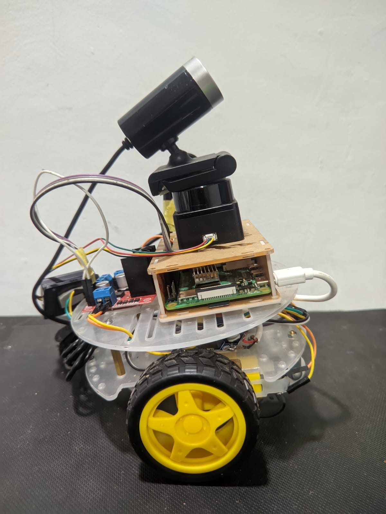
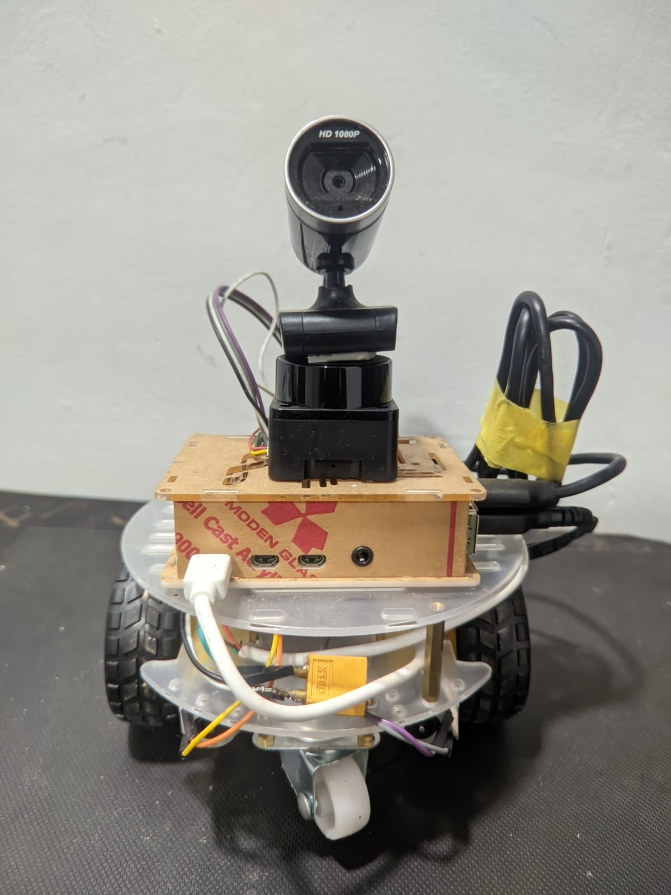
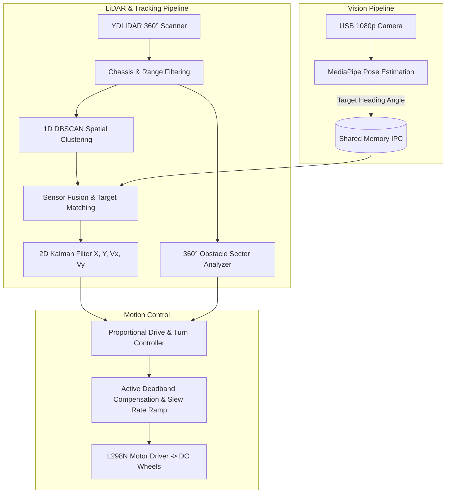

# 🛒 Autonomous Person-Following Smart Cart

[](https://www.python.org/downloads/)
[](https://developers.google.com/mediapipe)
[](https://www.ydlidar.com/)
[](LICENSE)

An intelligent, autonomous person-following mobile robotic platform powered by **Raspberry Pi**, **MediaPipe Vision**, and a **360° 2D LiDAR (YDLIDAR)**. The system implements real-time **Sensor Fusion**, a **2D Kalman Filter**, **360-degree Obstacle Avoidance**, and **Active Deadband Compensation** for smooth, natural human following.

---

## 📸 Hardware Showcase

<p align="center">
  
  
</p>
<p align="center"><em>Figure 1: (Left) Side Profile showing L298N driver, Raspberry Pi, and LiDAR stack. (Right) Front perspective with HD Webcam and caster assembly.</em></p>

---

## ✨ Key Features

- **🎯 Vision & LiDAR Sensor Fusion**: Combines fast MediaPipe pose angle detection with high-precision 360° LiDAR depth sensing to reliably isolate the user from background clutter.
- **🔄 2D Kalman Filter Tracking**: Predicts target position and velocity $(X, Y, V_x, V_y)$ at 10Hz, allowing continuous tracking even when the user is temporarily occluded or turns away from the camera.
- **🛡️ 360° Active Obstacle Avoidance**:
  - **Front Collision Guard**: Proportional soft braking when obstacles enter within 0.60m–0.35m.
  - **Side Repulsion**: Smoothly steers away from nearby walls or furniture while maintaining lock on the user.
  - **Rear Collision Guard**: Protects the robot from backing up into walls when reversing.
  - **Target Exclusion**: Intelligently ignores the tracked user's legs to prevent false-positive obstacle triggers.
- **🚗 Ultra-Smooth Motion & Deadband Compensation**:
  - Custom `logical_to_physical` motor mapping eliminates DC motor static friction ("stiction") without jerky bang-bang speed jumps.
  - Slew-rate limited acceleration/deceleration ramps.
  - 1.0m target following distance with a $\pm 0.20\text{m}$ stopping deadband.
- **⚡ Multi-Stage Fallback Tracker**: Seamlessly transitions between Camera+LiDAR fusion, Kalman Filter trajectory coasting, and LiDAR front auto-initialization.

---

## 🏗️ System Architecture



---

## 🔌 Hardware & Wiring Specification

### Bill of Materials (BOM)
| Component | Description |
|---|---|
| **SBC** | Raspberry Pi 4 Model B (or Pi 3B+) running Raspberry Pi OS (64-bit recommended) |
| **LiDAR** | YDLIDAR T-mini Plus / X4 / SCL (2D 360° Laser Scanner, USB Serial `/dev/ttyUSB0`) |
| **Camera** | USB HD 1080p Webcam |
| **Motor Driver** | L298N Dual H-Bridge Motor Driver Module |
| **Chassis** | 2-Tier Acrylic Circular Robot Chassis with 2x DC Geared Motors & Front Caster |
| **Power Supply** | 7.4V–11.1V (2S/3S LiPo or 18650 Battery Pack) with XT60 Connector + 5V Step-Down for Pi |

### Raspberry Pi GPIO Pinout (L298N Driver)
| L298N Pin | Raspberry Pi Pin | Description |
|---|---|---|
| **IN1** | `GPIO 17` (Pin 11) | Left Motor Forward |
| **IN2** | `GPIO 27` (Pin 13) | Left Motor Backward |
| **IN3** | `GPIO 22` (Pin 15) | Right Motor Forward |
| **IN4** | `GPIO 23` (Pin 16) | Right Motor Backward |
| **ENA / ENB** | 5V Jumpers Fitted | Full PWM output enabled |
| **GND** | Pin 6 / 9 / 14 / 20 | Common Ground with Battery & Pi |

---

## 🚀 Getting Started

### 1. Prerequisites & Environment Setup
Clone this repository to your Raspberry Pi:
```bash
git clone https://github.com/DaniduZe/Autonomous-person-following-robot.git
cd Autonomous-person-following-robot
```

Create and activate a Python virtual environment (e.g. with Miniforge or `venv`):
```bash
python3 -m venv robot_env
source robot_env/bin/activate
```

Install the required Python packages:
```bash
pip install -r requirements.txt
```

### 2. Install YDLIDAR-SDK
Build and install the official YDLIDAR C++ and Python SDK:
```bash
sudo apt update && sudo apt install cmake pkg-config build-essential swig
git clone https://github.com/YDLIDAR/YDLidar-SDK.git
cd YDLidar-SDK
mkdir build && cd build
cmake ..
make
sudo make install
cd ../python
python setup.py install
cd ../..
```

Ensure USB serial permissions are granted:
```bash
sudo usermod -a -G dialout $USER
```

---

## 🧪 Hardware Diagnostic Tests

Before running full tracking, verify each individual hardware subsystem using the included test utilities:

### 1. Test Camera & MediaPipe
Captures a sample frame and verifies pose landmark detection:
```bash
python test_camera.py
```

### 2. Test 360° LiDAR
Connects to `/dev/ttyUSB0` at `230400` baud and prints real-time scan metrics:
```bash
python test_lidar.py
```

### 3. Test Motor Driver & Direction
Runs forward/reverse sequences on left and right motors:
```bash
python test_motors.py
```

---

## 🎯 Running Autonomous Person-Following

Run the main sensor-fusion tracking script:
```bash
python follow_person_lidar.py
```
*(or run `python main.py`)*

### Operational Behavior:
1. **Startup**: Stand approximately **1.0m–1.5m in front of the robot**.
2. **Lock-On**: MediaPipe detects your torso heading; the LiDAR isolates your legs and initializes the Kalman Filter.
3. **Follow**: Walk forward, turn corners, or speed up. The cart smoothly follows and maintains a **1.0m distance**.
4. **Stop**: When you stop, the cart enters its $\pm 0.20\text{m}$ deadband and comes to a complete halt without jitter.
5. **Obstacle Avoidance**: If you walk close to a wall or furniture, the robot steers around the obstacle safely.

---

## ⚙️ Configuration & Tuning

Key tunable parameters located in [`follow_person_lidar.py`](follow_person_lidar.py):

| Parameter | Default | Description |
|---|---|---|
| `TARGET_DIST` | `1.00` | Target distance from user in meters |
| `DIST_DEADBAND` | `0.20` | Stopping deadband threshold ($\pm 20\text{cm}$) |
| `MAX_SPEED` | `0.50` | Maximum forward/reverse speed $(0.0 - 1.0)$ |
| `MAX_TURN_SPEED`| `0.35` | Maximum steering speed $(0.0 - 1.0)$ |
| `MOTOR_DEADBAND` | `0.16` | Minimum PWM duty cycle required to overcome wheel stiction |
| `K_DRIVE` | `0.60` | Proportional drive speed gain |
| `K_TURN` | `0.008` | Proportional steering turn gain |
| `MAX_SPEED_CHANGE` | `0.05` | Maximum acceleration slew rate per loop iteration |

---

## 📂 Repository Structure

```
├── assets/
│   ├── robot_side_view.jpg          # Hardware photo (side view)
│   └── robot_front_view.jpg         # Hardware photo (front view)
├── follow_person_lidar.py           # Main person-following sensor fusion engine
├── main.py                          # Primary entry point
├── test_camera.py                   # Camera & MediaPipe diagnostic script
├── test_lidar.py                    # YDLIDAR diagnostic script
├── test_motors.py                   # L298N motor driver diagnostic script
├── requirements.txt                 # Python dependencies
├── .gitignore                       # Standard Git ignore rules
├── LICENSE                          # MIT License
└── README.md                        # Project documentation
```

---

## 📄 License

This project is licensed under the **MIT License** - see the [LICENSE](LICENSE) file for details.

---

## 🤝 Contributing & Acknowledgments

Pull requests and issues are welcome! If you find this project helpful for your robotics or smart shopping cart projects, consider giving it a ⭐ on GitHub!
